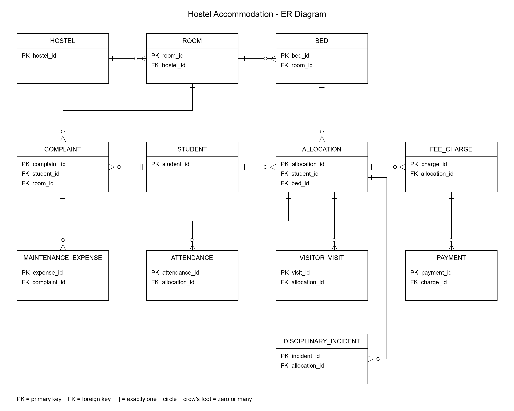

# University Hostel and Accommodation Management System

An academic Oracle SQL and PL/SQL project for managing hostel rooms, bed allocations, fees, attendance, complaints, visitors, and disciplinary records. Includes **14 tables**, **6 views**, **5 integrity triggers**, **21 reports**, and **33 automated assertions**. All sample data is inserted manually.



## Project files

| File | Purpose |
|---|---|
| [01_schema.sql](hostel_oracle/01_schema.sql) | Tables, constraints, indexes, and triggers |
| [02_sample_data.sql](hostel_oracle/02_sample_data.sql) | Sample records |
| [03_views.sql](hostel_oracle/03_views.sql) | Reporting views |
| [04_reports.sql](hostel_oracle/04_reports.sql) | Reports Q01-Q21 |
| [05_verify.sql](hostel_oracle/05_verify.sql) | Assertions and reversible data-change demonstrations |
| [run_all.sql](hostel_oracle/run_all.sql) | Modular installer |
| [hostel_complete.sql](hostel_oracle/hostel_complete.sql) | Standalone installer for SQL Developer |
| [Problem Statement.pdf](Problem%20Statement.pdf) | Problem Statement |

## Setup and usage

Use **Oracle Database 19c or later** with SQL*Plus, SQLcl, or SQL Developer. The project account needs CREATE SESSION, CREATE TABLE, CREATE VIEW, CREATE TRIGGER, CREATE PROCEDURE, and a tablespace quota. SYS and SYSTEM are rejected; CURRENT_SCHEMA must match the connected user.

From the repository root, connect with your own details and enter your password when prompted:

```sql
CONNECT your_user@localhost:1521/your_service
@hostel_oracle/run_all.sql
```

In SQL Developer, open `hostel_oracle/hostel_complete.sql` and select **Run Script (F5)** instead. Run only one installer, once per schema. Conflicting project object or constraint names stop installation; existing objects are not automatically replaced.

Expected completion messages:

```text
ALL ASSERTIONS PASSED. Baseline data preserved.
Installation, assertions, and reports completed.
```

Oracle DDL commits automatically, and the installer commits sample data. Finish unrelated transactions first. A failed installation may leave partially created objects.

After installation, rerun reports or verification without reinstalling:

```sql
@hostel_oracle/04_reports.sql
@hostel_oracle/05_verify.sql
```

Verification assumes the original sample data and reporting dates. Its demonstration changes are rolled back.

## Database design

A hostel contains rooms, and each room contains beds. Allocations connect students to beds over time. Each allocation can have fee charges, attendance, visits, and incidents. Charges can have multiple payments; complaints link students to rooms and can have multiple expenses.

Each relationship is one-to-many: a parent may have no children, while each child requires its referenced parent. Separate transaction tables preserve history and avoid duplicate totals. Views calculate occupancy, balances, attendance percentages, and support scores.

### Entities, attributes and relational schema

| Relation | Primary key (PK) | Other attributes | Foreign-key references |
|---|---|---|---|
| `STUDENT` | `student_id` | `registration_no` UK, `student_name`, `department`, `email` UK, `phone`, `emergency_contact` | None |
| `HOSTEL` | `hostel_id` | `hostel_name` UK, `location` | None |
| `ROOM` | `room_id` | `hostel_id` FK, `room_no`, `room_type` | `hostel_id -> HOSTEL.hostel_id` |
| `BED` | `bed_id` | `room_id` FK, `bed_no`, `service_status` | `room_id -> ROOM.room_id` |
| `ALLOCATION` | `allocation_id` | `student_id` FK, `bed_id` FK, `start_date`, `end_date` | `student_id -> STUDENT.student_id`; `bed_id -> BED.bed_id` |
| `FEE_CHARGE` | `charge_id` | `allocation_id` FK, `billing_period`, `charge_date`, `due_date`, `amount` | `allocation_id -> ALLOCATION.allocation_id` |
| `PAYMENT` | `payment_id` | `charge_id` FK, `payment_date`, `amount`, `payment_mode`, `receipt_no` UK | `charge_id -> FEE_CHARGE.charge_id` |
| `ATTENDANCE` | `attendance_id` | `allocation_id` FK, `attendance_date`, `attendance_status` | `allocation_id -> ALLOCATION.allocation_id` |
| `COMPLAINT` | `complaint_id` | `student_id` FK, `room_id` FK, `category`, `description`, `raised_date`, `status`, `resolved_date` | `student_id -> STUDENT.student_id`; `room_id -> ROOM.room_id` |
| `MAINTENANCE_EXPENSE` | `expense_id` | `complaint_id` FK, `expense_date`, `amount`, `description` | `complaint_id -> COMPLAINT.complaint_id` |
| `VISITOR_VISIT` | `visit_id` | `allocation_id` FK, `visitor_name`, `relationship`, `entry_time`, `exit_time` | `allocation_id -> ALLOCATION.allocation_id` |
| `DISCIPLINARY_INCIDENT` | `incident_id` | `allocation_id` FK, `incident_date`, `incident_type`, `severity`, `action_taken` | `allocation_id -> ALLOCATION.allocation_id` |

Two helper tables complete the schema: `REPORT_CONFIG` stores reporting dates and the occupancy benchmark; `C6_WRITE_LOCK` supports allocation and finance transaction locks. They are omitted from the business ER diagram. Exact data types and constraints are in [01_schema.sql](hostel_oracle/01_schema.sql).

## Main rules

- Allocation periods include the start date and exclude the end date; a null end date means an ongoing stay. Student and bed bookings cannot overlap. Transfers close the old allocation and create a new one.
- An `AVAILABLE` bed is serviceable; it is vacant only when no allocation is active at the cutoff. Occupied or future-booked beds cannot be disabled until their bookings are closed or moved.
- Attendance dates must fall within the allocation. Duplicate attendance for the same allocation and date is rejected.
- Charges and payments must be positive. Payments cannot precede or exceed their charge; charges cannot be reduced below existing payments.
- Keys, checks, and unique constraints protect references, statuses, dates, room/bed numbers, and billing periods. IDs are entered explicitly.

This is a lab model. Refunds, fee waivers, billing proration, full historical auditing, and automatic residency/date checks for complaints, visits, and incidents are outside its scope. Shared write locks suit a small demonstration; multi-session concurrency tests are not included.

## Reports and assignment coverage

| Assignment section | Implementation |
|---|---|
| 1. Requirements and design | ER diagram, relational schema, relationships, and rules above |
| 2. Implementation and data management | Schema creation, `ALTER TABLE`, sample inserts, integrity constraints, and reversible INSERT/UPDATE/DELETE demonstrations |
| 3. SQL analysis | Q01-Q10 cover occupancy, room use, attendance, collections, dues, complaints, student statistics, recurring problems, incidents, and support priorities |
| 4. Advanced SQL | Q11-Q17 cover above-average balances, occupancy benchmarks, repeated complaints/incidents, hostel-average attendance, maintenance costs, and hostel performance. Q14 uses a correlated subquery |
| 5. Support identification | Views combine attendance, fees, unresolved complaints, and incidents into an explainable priority score |

Q18 lists vacant serviceable beds, Q19 shows visitor history, Q20 shows allocation history, and Q21 lists residents needing attention. Queries use joins, filtering, grouping, aggregates, and subqueries.

The six views are `V_CURRENT_RESIDENCE`, `V_FEE_BALANCE`, `V_HOSTEL_OCCUPANCY`, `V_STUDENT_SUPPORT_STATS`, `V_STUDENT_SUPPORT_RISK`, and `V_HOSTEL_PERFORMANCE`. Related records are aggregated before joining to avoid inflated counts and balances.

## Reporting and support priorities

The default window is **6 September-5 October 2026**, with a cutoff of **6 October 2026 at 00:00**. Events use `>= window_start AND < as_of_date`; occupancy uses allocations active at the cutoff. Dates can be changed in `REPORT_CONFIG`, but baseline assertions require the original configuration.

Attendance is present / (present + absent) × 100; approved leave is excluded and missing records are reported separately. Outstanding fees include charges minus payments before the cutoff. Window collections count only payments within the reporting window. Occupancy is occupied / serviceable beds × 100, with a 90% planning benchmark.

Only current residents receive a support classification:

| Indicator | 0 points | 1 point | 2 points |
|---|---|---|---|
| Attendance | >=85% | 75% to <85% | <75% |
| Outstanding fee (INR) | 0 | >0 to 10,000 | >10,000 |
| Unresolved complaints raised in the window | 0-1 | 2-3 | >=4 |
| Incidents in the window | 0 | 1 | >=2 |

Scores **>=5** mean HIGH PRIORITY; **2-4** mean NEEDS ATTENTION; **0-1** mean NORMAL. Missing or undefined attendance requires at least NEEDS ATTENTION. These are illustrative thresholds for human review and support, not official university policy. Complaints indicate maintenance needs and should not penalize students.

## Expected sample results

These values are derived from the supplied data; capture an actual Oracle run as execution evidence.

| Measure | Expected |
|---|---:|
| Students / current residents | 19 / 18 |
| Hostels / rooms / beds | 3 / 9 / 27 |
| Serviceable / occupied / vacant beds | 26 / 18 / 8 |
| Attendance records / missing days | 538 / 2 |
| Total charges / cumulative payments / outstanding (INR) | 324,000 / 277,000 / 47,000 |
| Collections in the window (INR) | 138,500 |
| Maintenance expenditure (INR) | 5,000 |
| HIGH PRIORITY / NEEDS ATTENTION / NORMAL | 2 / 3 / 13 |

Students 1 and 7 are HIGH PRIORITY; students 2, 8, and 18 NEED ATTENTION. Student 18 has missing attendance despite 100% attendance among recorded days. Student 19 has no allocation and is excluded from classification.
