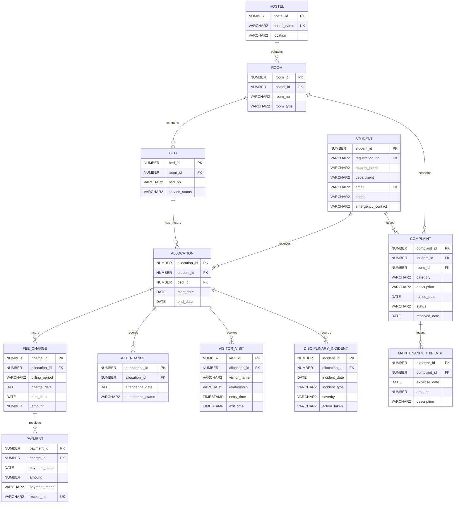

# Hostel accommodation ER diagram

The rendered [PNG](er_diagram.png), [SVG](er_diagram.svg), and [detailed Mermaid source](er_diagram_detailed.mmd) are in this folder.

Each child has exactly one parent; each parent may have zero or more children. Student and bed allocations are many over time, with overlapping allocations prohibited.

PK = primary key; FK = foreign key; UK = unique key. Compound unique keys: Room(hostel_id, room_no), Bed(room_id, bed_no), FeeCharge(allocation_id, billing_period), Attendance(allocation_id, attendance_date). Reporting configuration and transaction lock tables are technical helpers and are omitted.
